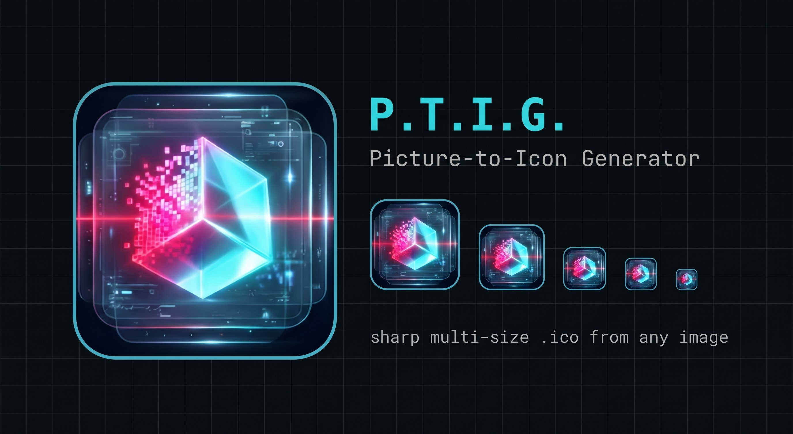

<p align="center">
  
</p>

<p align="center">
  
  
  
  
  
</p>

# P. T. I. G. - Picture-to-icon Generator

Локальная утилита для Windows, которая делает чёткие многоразмерные иконки `.ico` из любой картинки. Есть графический интерфейс и командная строка. Каждый размер (16×16, 24×24 и так далее) рисуется отдельно из исходника, а не получается сжатием одной большой картинки, поэтому мелкие кадры остаются читаемыми.

## ⚙️ Как работает движок

- **Независимый рендер каждого размера.** Рамка, скругление и маска пересчитываются под каждый кадр, а не масштабируются вместе с картинкой.
- **Гладкие края.** Маски формы рисуются в 4 раза крупнее и сжимаются обратно (суперсемплинг), поэтому у круга и скруглений нет «лесенки».
- **Один проход ресемплинга.** Картинка масштабируется через предумноженную альфу, из-за чего на границах прозрачности не появляется светлой каймы.
- **Всеядный загрузчик.** PNG, JPG/JFIF, WEBP, BMP, GIF, TIFF, ICO, PSD, TGA, SVG и другие. HEIC и AVIF читаются, если установлены плагины. Из многокадровых файлов берётся самый крупный кадр.
- **Самодиагностика.** Проверяет читаемость кадра 16×16, целостность контейнера `.ico`, наличие базовых размеров Windows (16, 32, 48, 256) и разрешение исходника.

## 🖥️ Возможности интерфейса

- Перетаскивание картинки прямо в окно (Drag & Drop) или выбор через диалог.
- Кадрирование: срезы по краям (убрать водяной знак или подпись), зум, сдвиг окна, режимы `cover` (заполнить) и `contain` (вписать целиком).
- Форма: скруглённый квадрат, круг или квадрат.
- Неоновая рамка: цвет, прозрачность, толщина, отступ.
- Размеры от 8 до 256 px; по умолчанию 16, 20, 24, 32, 40, 48, 64, 128, 256.
- Живое превью на тёмном и светлом фоне, телеметрия по каждому размеру.
- Профили настроек в JSON: настроил стиль один раз и применяешь к любым картинкам.
- Экспорт: `.ico`, лист превью и отдельные PNG для каждого размера.

## 📥 Скачать и запустить

Готовый `.exe` без установки Python лежит в разделе **[Releases](../../releases)**. Скачай, распакуй и запускай.

## 🛠️ Запуск из исходников и сборка .exe

```bash
git clone https://github.com/U9iN/Icon_Maker.git
cd Icon_Maker
pip install -r requirements.txt
python icon_launcher.py
```

Сборка exe выполняется через `build.bat` (PyInstaller):

- `build.bat` — сборка в папку, без консоли.
- `build.bat onefile` — один автономный `.exe`.
- `build.bat debug` — с открытой консолью, чтобы видеть ошибки.
- Режимы комбинируются: `build.bat onefile debug`.

Python скрипт находит сам (`.venv`, затем системный) или берёт путь из переменной `IM_PYTHON`. Недостающие пакеты он доустанавливает. Результат появляется в папке `dist\`.

## ⌨️ Командная строка

```bash
# Создать logo.ico из logo.png
python make_icon.py logo.png

# Свой путь, срезать 9% снизу, приблизить
python make_icon.py logo.png -o app.ico --trim-bottom 0.09 --zoom 1.15

# Круглая иконка без рамки и лист превью
python make_icon.py logo.png --shape circle --no-border --preview

# Сохранить настройки в профиль и применить к другой картинке
python make_icon.py logo.png --save-profile neon.json
python make_icon.py other.png --profile neon.json --border-color "#ff2a85"
```

Все параметры: `python make_icon.py --help`.

## 📂 Состав проекта

| Файл | Назначение |
|---|---|
| `make_icon.py` | Графический движок, диагностика и CLI |
| `icon_launcher.py` | Запуск окна и мост между интерфейсом и движком |
| `icon_gui.html` | Интерфейс |
| `icon.ico` | Иконка самого приложения |
| `build.bat` | Сборка exe |

---

<details>
<summary><b>🇬🇧 English version</b></summary>

**I.M.G. — Icon Maker Generator** is a local Windows utility that builds sharp multi-size `.ico` files from any image, with a GUI (pywebview) and a command-line interface. Every size is rendered separately from the source, so small frames (16×16, 24×24) stay crisp instead of being downscaled from one big picture.

### Key features

- **Per-size rendering:** border, corner radius and mask are recalculated for each frame.
- **Smooth edges:** 4× supersampled masks.
- **Wide format support:** PNG, JPG, WEBP, BMP, GIF, TIFF, ICO, PSD, TGA, SVG and more (HEIC/AVIF with plugins).
- **Cropping and shapes:** edge trimming, zoom, offset, `cover`/`contain`, rounded square / circle / square, neon border.
- **JSON profiles:** save a style once, reuse it for any image.
- **Self-diagnostics:** checks 16×16 legibility, `.ico` integrity and Windows core sizes.

### Quick start

```bash
pip install -r requirements.txt
python icon_launcher.py
```

Prebuilt Windows binary: see **[Releases](../../releases)**.

</details>

## 📄 Лицензия

MIT, см. файл [LICENSE].
